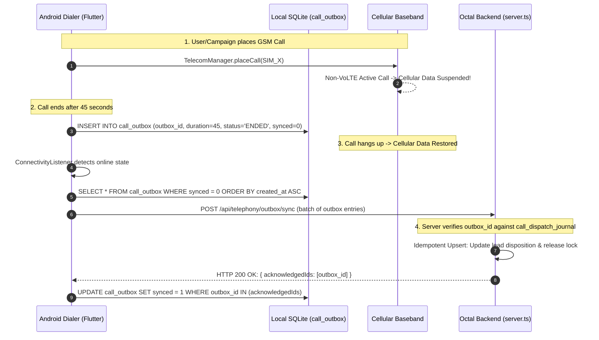

# GSM SIM Health, Data-Drop Resilience & Compliance Architecture

Octal Dialer operates over **physical cellular GSM Dual-SIM hardware on Android** (`application_octal_dialer`), NOT VoIP, SIP, or WebRTC. Calls route through physical carrier SIM cards over the PSTN air interface. Because this is true cellular telephony, traditional VoIP assumptions fail: data drops during calls on non-VoLTE networks, STIR/SHAKEN does not apply to consumer basebands, and carrier telecom algorithms actively police SIM behavioral patterns.

---

## 1. GSM Cellular Telephony vs VoIP/SIP Paradigm

### Why STIR/SHAKEN Does Not Apply
- **VoIP / SIP Trunking**: Calls originate as SIP `INVITE` packets containing RFC 8588 `Identity` headers. STIR/SHAKEN attestation levels (A, B, C) are signed via X.509 certificates by VoIP carriers to prove caller ID ownership.
- **Octal GSM Dialer**: Calls originate from Android's baseband processor (`TelecomManager.placeCall()`) over physical GSM/LTE/5G radio channels. The caller ID is **hard-coded to the physical SIM card's IMSI/MSISDN** assigned by the cellular network operator (AT&T, T-Mobile, Vodafone, Airtel, etc.). The carrier's Mobile Switching Center (MSC) and Home Location Register (HLR) authenticate the SIM cryptographically over the SIM's Ki/OPc secret keys.
- **Rule**: Never attempt to inject SIP headers, STIR/SHAKEN tokens, or artificial Caller ID spoofing into the Android GSM call path. Caller ID is strictly governed by the active SIM slot.

### Carrier SIM Detection Vectors
Cellular carriers utilize real-time fraud management systems (FMS) and automated SIM box detection algorithms:
1. **Robotic Cadence**: Exact mathematical gaps between calls (e.g. exactly 10.0 seconds).
2. **Abnormal Short-Call Distribution**: An unusually high percentage of calls under 12 seconds (unanswered/rejected/voicemail bursts).
3. **One-Way Traffic Asymmetry**: Placing 300 outbound calls with zero incoming calls or SMS messages.
4. **Cell Tower Pinning**: Generating hundreds of calls through a single base station cell-ID without typical subscriber mobility patterns.

---

## 2. Android Non-VoLTE Dual-SIM Data-Drop Resilience

### The Physical Root Cause
In Dual-SIM Dual-Standby (DSDS) Android devices, both SIMs share a single radio frequency (RF) transceiver. Furthermore, on non-VoLTE (Circuit Switched 2G/3G) networks or carriers where simultaneous voice and data (SVLTE) is disabled:
> **The instant a GSM voice call connects, packet data (4G/5G LTE cellular data) is suspended by the Android baseband.**

If the phone is running on cellular data (not connected to Wi-Fi), **the WebSocket connection (`socket_io_client`) to the Octal backend immediately drops**.

### Defensive Data-Drop Contract
1. **Never Block Call Progress on Network Connectivity**:
   - The Android app (`application_octal_dialer`) must never wait for backend HTTP/Socket confirmation to transition call screens, show hangup buttons, or record call duration.
   - All state transitions (`DIAL_INITIATED`, `CALL_RINGING`, `CALL_CONNECTED`, `CALL_ENDED`) are executed locally by `TelecomService` and stored in SQLite.

2. **Pre-Call Next Contact Buffering**:
   - Before dispatching the dial intent to Android `TelecomManager`, the web backend pre-stages the call target and pre-fetches lead metadata while data is still alive.

3. **Re-connection & Socket Re-establishment**:
   - When the call terminates and cellular data restores, the Android socket automatically reconnects.
   - The device immediately emits `device:sync_outbox` to flush queued telemetry.

---

## 3. Flutter SQLite Call Outbox & Idempotent Sync

When cellular data drops during a call, outcome telemetry (`CALL_CONNECTED`, `CALL_ENDED`, duration, audio recording path) cannot be lost in volatile memory.

### SQLite Outbox Schema (`application_octal_dialer`)
All call outcomes are committed to persistent device storage before any network dispatch is attempted:

```sql
CREATE TABLE IF NOT EXISTS call_outbox (
  outbox_id TEXT PRIMARY KEY,          -- UUID v4 generated on device
  call_id TEXT NOT NULL,               -- Unique call session identifier
  session_id TEXT NOT NULL,            -- Campaign/Agent session ID
  command_id TEXT,                     -- Web command dispatch ID
  lead_id TEXT,                        -- Associated CRM lead ID
  phone_number TEXT NOT NULL,          -- Recipient E.164 phone number
  sim_slot INTEGER NOT NULL,           -- 0 (SIM 1) or 1 (SIM 2)
  status TEXT NOT NULL,                -- 'CONNECTED', 'ENDED', 'MISSED', 'FAILED'
  duration INTEGER NOT NULL DEFAULT 0, -- Talk duration in seconds
  recording_path TEXT,                 -- Local filesystem path to .m4a/.wav
  created_at INTEGER NOT NULL,         -- Epoch timestamp ms
  sync_attempts INTEGER DEFAULT 0,     -- Exponential backoff counter
  last_attempt_at INTEGER DEFAULT 0,   -- Timestamp of last sync attempt
  synced INTEGER NOT NULL DEFAULT 0    -- 0 = pending, 1 = acknowledged by server
);

CREATE INDEX IF NOT EXISTS idx_outbox_pending ON call_outbox(synced, created_at);
```

### Idempotent Sync Lifecycle (`CallOutboxService`)


### Idempotency Guarantee
The backend matches incoming entries on `outbox_id` and `command_id` against `call_dispatch_journal`. If a network timeout occurs after the server saves the disposition but before the client receives the ACK, the client will retry the same `outbox_id`. The server detects the existing `outbox_id`, skips duplicate lead disposition writes, and safely returns an HTTP 200 acknowledgment.

---

## 4. Backend Dynamic `reserveLead()` Lease TTL Extension

### The Stale Lock Problem
In `databaseManager.ts`, the default lease TTL is `LEASE_TTL_MINUTES = 2`:
```sql
UPDATE leads 
SET "lockedBy" = $1, "lockedAt" = $2, status = 'CALLING'
WHERE id = $3 
  AND ("lockedBy" IS NULL OR "lockedBy" = $1 OR "lockedAt" < $cutoff)
```
If a representative is on a 15-minute GSM phone call while cellular data is suspended, no socket heartbeats can be transmitted. After 2 minutes, `lockedAt < cutoff` becomes true, and another automated dialer instance could re-reserve and dial the exact same lead, resulting in catastrophic dual-dial harassment.

### Dynamic Lease Protocol
1. **DIAL_INITIATED Lease Extension**:
   Upon receiving `DIAL_INITIATED` ACK from the mobile client, the backend extends the lead lease TTL to an initial generous calling window (e.g. 10 minutes):
   ```sql
   UPDATE leads
   SET "lockedAt" = NOW() + INTERVAL '10 minutes',
       "status" = 'IN_CALL'
   WHERE id = $1 AND "tenantId" = $2;
   ```

2. **Pessimistic Hold with In-Call Protection**:
   While `status = 'IN_CALL'`, automated dialer sweeps must never preemptively steal the lead, even if `lockedAt` passes the standard threshold, until either:
   - A valid outbox outcome is synced for this `leadId`.
   - A hard safety ceiling (e.g., 60 minutes) is reached, triggering an orphaned call cleanup check.

---

## 5. Carrier SIM Anti-Ban & Health Engine

To prevent cellular network providers from blacklisting or throttling SIM cards, the dialer implements a multi-tiered behavioral safety controller.

### A. Randomized Human-like Jitter
Robotic dialers place calls at fixed clock intervals. Octal enforces pseudo-randomized jitter between successive calls:
```dart
int calculateInterCallJitter({int baseDelaySec = 15, int maxJitterSec = 30}) {
  final random = math.Random();
  // Produces a realistic human delay between 15s and 45s with non-uniform distribution
  final jitter = random.nextInt(maxJitterSec + 1);
  return baseDelaySec + jitter;
}
```

### B. Dual-SIM Slot Round-Robin & Load Balancing
Distribute call volume equally across physical SIM slots to reduce per-SIM calling signatures:
```dart
class SimBalanceManager {
  int _currentSlot = 0; // 0 = SIM 1, 1 = SIM 2

  int getNextAvailableSimSlot({
    required SimStats sim1Stats,
    required SimStats sim2Stats,
    required DialerLimits limits,
  }) {
    final sim1Eligible = sim1Stats.hourlyCalls < limits.maxHourlyPerSim && 
                         sim1Stats.dailyCalls < limits.maxDailyPerSim && 
                         !sim1Stats.isCoolingDown;
                         
    final sim2Eligible = sim2Stats.hourlyCalls < limits.maxHourlyPerSim && 
                         sim2Stats.dailyCalls < limits.maxDailyPerSim && 
                         !sim2Stats.isCoolingDown;

    if (!sim1Eligible && !sim2Eligible) {
      throw AllSimsThrottledException("Both SIM cards have reached limits or are in cooldown.");
    }
    if (sim1Eligible && !sim2Eligible) return 0;
    if (!sim1Eligible && sim2Eligible) return 1;

    // Both eligible: Alternate slots
    final selected = _currentSlot;
    _currentSlot = (_currentSlot == 0) ? 1 : 0;
    return selected;
  }
}
```

### C. Configurable Hourly & Daily SIM Caps
Never exceed carrier thresholds:
- **Maximum Hourly Calls Per SIM**: 35 calls / hour.
- **Maximum Daily Calls Per SIM**: 150 - 200 calls / day.
- Once a SIM reaches its hourly cap, the dialer automatically parks the slot until the start of the next hour.

### D. Automated Cooldown on Short-Call / Drop Spikes
When a carrier flags a phone number, calls are frequently routed directly to carrier intercept or instant busy signals.
- **Short-Call Definition**: Any call lasting `< 12 seconds`.
- **Trigger**: If `shortCallCount / totalCalls > 0.40` across the last 15 calls on a SIM:
  1. Trigger immediate **SIM Cooldown** for 45 minutes.
  2. Emit `sim:cooldown_alert` to the Web Dialer UI: `"SIM 1 placed in automated cooldown due to high disconnect ratio."`
  3. Route remaining queue traffic through SIM 2 (if available).

---

## 6. TCPA Compliance & Local Timezone Calling Windows

### The Legal Rule
Under the Telephone Consumer Protection Act (TCPA) and state telemarketing regulations:
> **Outbound telemarketing calls may only be placed between 8:00 AM and 9:00 PM recipient local time.**

Violations carry statutory damages of \$500 to \$1,500 **per call**.

### NANP Area Code to Timezone Resolution Matrix
Every target phone number must be evaluated against recipient local time, NOT agent local time or server UTC.

```typescript
// website_octal_dialer/backend/src/safetyController.ts

export interface TimezoneWindow {
  iana: string;
  utcOffset: number;
}

// Major Area Code Map (Representative sample for US timezones)
const AREA_CODE_TIMEZONE_MAP: Record<string, string> = {
  // Eastern (America/New_York)
  '212': 'America/New_York', '646': 'America/New_York', '305': 'America/New_York',
  '404': 'America/New_York', '617': 'America/New_York', '215': 'America/New_York',
  // Central (America/Chicago)
  '312': 'America/Chicago', '773': 'America/Chicago', '713': 'America/Chicago',
  '214': 'America/Chicago', '612': 'America/Chicago', '615': 'America/Chicago',
  // Mountain (America/Denver)
  '303': 'America/Denver', '720': 'America/Denver', '602': 'America/Phoenix',
  '801': 'America/Denver', '505': 'America/Denver',
  // Pacific (America/Los_Angeles)
  '213': 'America/Los_Angeles', '310': 'America/Los_Angeles', '415': 'America/Los_Angeles',
  '206': 'America/Los_Angeles', '503': 'America/Los_Angeles', '858': 'America/Los_Angeles',
  // Alaska & Hawaii
  '907': 'America/Anchorage',
  '808': 'Pacific/Honolulu'
};

export function isWithinTcpaWindow(phoneNumber: string): { allowed: boolean; reason?: string; recipientLocalTime?: string } {
  const cleaned = phoneNumber.replace(/\D/g, '');
  const areaCode = cleaned.length === 11 && cleaned.startsWith('1') 
    ? cleaned.substring(1, 4) 
    : cleaned.substring(0, 3);

  const timezone = AREA_CODE_TIMEZONE_MAP[areaCode] || 'America/New_York'; // Fallback to Eastern
  
  // Calculate current local hour in recipient timezone
  const now = new Date();
  const recipientTimeStr = now.toLocaleTimeString('en-US', { timeZone: timezone, hour12: false, hour: '2-digit', minute: '2-digit' });
  const [hourStr, minuteStr] = recipientTimeStr.split(':');
  const currentHour = parseInt(hourStr, 10);

  if (currentHour < 8 || currentHour >= 21) {
    return {
      allowed: false,
      reason: `TCPA Curfew: Recipient local time is ${recipientTimeStr} (${timezone}). Calling only permitted 08:00 - 21:00.`,
      recipientLocalTime: recipientTimeStr
    };
  }

  return { allowed: true, recipientLocalTime: recipientTimeStr };
}
```

### Pre-Dial DNC (Do-Not-Call) Registry Check
Before dispatching any lead to the mobile outbox:
1. Normalize phone to E.164 (`+1XXXXXXXXXX`).
2. Query the tenant suppression table and system-wide DNC registry:
```sql
SELECT id FROM dnc_numbers 
WHERE "tenantId" = $1 AND "phoneNumber" = $2
LIMIT 1;
```
3. If matched, immediately mark lead as `STATUS = 'DNC_BLOCKED'`, append to activity audit log, and advance queue without sending command to mobile device.

---

## 7. Verification & Telephony Audit Runbook

Whenever touching mobile calling logic or telephony routes:

```bash
# 1. Verify Dart telecom models and outbox service
cd application_octal_dialer
flutter analyze
# Must output: No issues found!

# 2. Run backend safety controller and telephony suites
npm --prefix website_octal_dialer/backend test tests/safetyController.test.ts
npm test

# 3. Simulate Data-Drop Sync in local test harness:
# - Connect Android device via ADB
# - Trigger call via Web Dialer
# - Disable mobile data via: adb shell svc data disable
# - Verify call completes and outbox entry exists in SQLite
# - Re-enable data: adb shell svc data enable
# - Verify outbox batch flush HTTP 200 and lead disposition update
```
