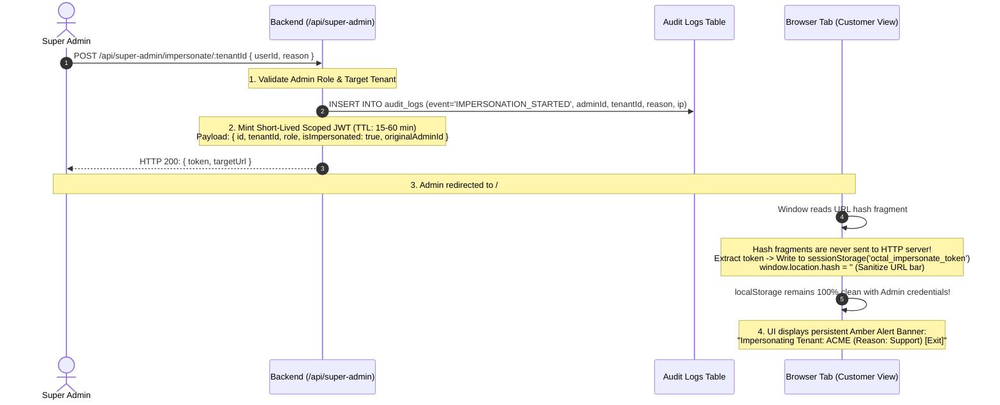

# Multi-Tenant RLS & Platform Authority Security Architecture

Octal Dialer / Zestify enforces a **defense-in-depth multi-tenant isolation model**. Cross-tenant data leakage is an existential failure for a multi-tenant SaaS. Relying on application-level `WHERE "tenantId" = $1` alone creates single-point-of-failure vulnerability if an engineer omits a clause. Conversely, relying solely on database triggers can bypass indexed execution plans. We mandate dual-layer security across database engine and application code.

---

## 1. Defense-in-Depth Isolation Model

### Layer 1: Application-Level Parameterized SQL
Every SQL query targeting tenant-owned entities MUST explicitly filter on `"tenantId"` using parameterized values (`$1`, `$2`). Never concatenate raw strings.
```typescript
// MANDATORY Application-Level Scoping
const result = await db.execute(`
  SELECT id, name, phone, status 
  FROM leads 
  WHERE "tenantId" = $1 AND id = $2
`, [tenantId, leadId]);
```

### Layer 2: PostgreSQL Row-Level Security (RLS)
PostgreSQL's native Row-Level Security acts as the **kernel boundary**. If an application bug, unhandled endpoint, or refactored query inadvertently omits `WHERE "tenantId" = $X`, the PostgreSQL query planner intercepts the query and automatically appends the RLS predicate before execution.

```sql
-- Enable and force RLS on all operational tenant tables
ALTER TABLE "leads" ENABLE ROW LEVEL SECURITY;
ALTER TABLE "leads" FORCE ROW LEVEL SECURITY;

ALTER TABLE "crm_contacts" ENABLE ROW LEVEL SECURITY;
ALTER TABLE "crm_contacts" FORCE ROW LEVEL SECURITY;

ALTER TABLE "dispositions" ENABLE ROW LEVEL SECURITY;
ALTER TABLE "dispositions" FORCE ROW LEVEL SECURITY;

-- Tenant Isolation Policy
CREATE POLICY tenant_isolation_policy ON "leads"
  AS RESTRICTIVE
  FOR ALL
  USING (
    "tenantId" = NULLIF(current_setting('app.current_tenant_id', true), '')
  )
  WITH CHECK (
    "tenantId" = NULLIF(current_setting('app.current_tenant_id', true), '')
  );
```

---

## 2. PostgreSQL Connection Pooling & Transaction-Scoped Context

### The Connection Pool Contamination Pitfall
PostgreSQL connection pools (`pg.Pool`) maintain long-lived TCP connections reused by hundreds of concurrent HTTP requests.
- **FATAL ERROR**: Executing `SET app.current_tenant_id = 'tenant_123'` sets the variable at the **session level**. When that connection is returned to the pool and checked out by a request for `tenant_456`, if setting the context fails, `tenant_456` will execute inside `tenant_123`'s context!
- **MANDATORY CONTRACT**: Context setting MUST be **transaction-scoped** using `set_config('app.current_tenant_id', $1, true)`.

### The Transaction-Scoped Context Pattern (`set_config`)
In PostgreSQL, setting a transaction-scoped variable with parameterized inputs cannot use `SET LOCAL` with parameter placeholders (e.g. attempting to bind `$1` in `SET LOCAL`) because `node-postgres` (`pg`) and the PostgreSQL extended query protocol cannot bind parameters in utility statements like `SET` (resulting in a PostgreSQL syntax error: `syntax error at or near "$1"`).

Instead, execute `SELECT set_config('app.current_tenant_id', $1, true);`:
- **Safe parameter binding**: Safely binds `$1` without raw string interpolation or SQL injection risk.
- **Transaction-scoped (3rd parameter `true`)**: The third parameter (`is_local = true`) binds configuration parameters strictly to the duration of the current transaction (`BEGIN ... COMMIT / ROLLBACK`), equivalent to `SET LOCAL`. When the transaction finishes, PostgreSQL automatically resets the setting to empty or its prior session value, preventing connection pool contamination.

```typescript
// website_octal_dialer/backend/src/db/pool.ts

export async function withTenantContext<T>(
  tenantId: string, 
  callback: (client: PoolClient) => Promise<T>
): Promise<T> {
  if (!tenantId) {
    throw new Error('[Security Exception] withTenantContext invoked without tenantId');
  }

  const client = await pool.connect();
  try {
    await client.query('BEGIN');
    
    // Bind context strictly to this transaction (3rd argument true = transaction-local)
    await client.query("SELECT set_config('app.current_tenant_id', $1, true);", [tenantId]);
    
    const result = await callback(client);
    
    await client.query('COMMIT');
    return result;
  } catch (err) {
    await client.query('ROLLBACK');
    throw err;
  } finally {
    client.release(); // Clean connection returned to pool with no residual tenant state
  }
}
```

---

## 3. Super Admin Plane vs Customer Tenant Plane Isolation

Octal Dialer maintains an immutable boundary between Platform Administrators and Customer Workspaces (enforced in Migration `018_platform_authority_isolation.sql`).

```
┌────────────────────────────────────────────────────────┐
│               PLATFORM SUPER ADMIN PLANE               │
│  - Roles: super_admin, platform_admin, master_admin     │
│  - tenantId = NULL (Strictly detached from customers)  │
│  - Zero Customer Seat Consumption                      │
│  - Cannot be assigned customer leads/tasks/teams       │
└──────────────────────────┬─────────────────────────────┘
                           │ Audited Impersonation Bridge
                           ▼ (Short TTL, Hash Handoff, SessionStorage)
┌────────────────────────────────────────────────────────┐
│                 CUSTOMER TENANT PLANE                  │
│  - Roles: company_owner, admin, team_lead, member      │
│  - tenantId = "ten_xxx" (Mandatory in JWT claims)      │
│  - Bounded by RLS & team entitlement limits            │
└────────────────────────────────────────────────────────┘
```

### Immutable Authority Rules
1. **Platform Admins Have `tenantId = NULL`**:
   Any platform admin row in `users` must have `tenantId IS NULL`. No customer workspace can contain a user with platform admin privileges.
2. **Zero Seat Consumption**:
   Customer license billing computes seats via:
   ```sql
   SELECT COUNT(*) FROM "users" 
   WHERE "tenantId" = $1 AND LOWER("role") NOT IN ('super_admin', 'platform_admin', 'master_admin');
   ```
   Platform admins never increment or decrement customer seat limits.
3. **Queue & Team Exclusion**:
   Platform admin IDs are banned from `team_members`, `assignedTo` in `leads`, and `assignedUserId` in `crm_tasks`.

---

## 4. Audited Super Admin Impersonation Protocol

Platform admins frequently need to troubleshoot customer workspaces. Standard insecure implementations overwrite `localStorage.token`, which pollutes the browser, persists admin tokens in customer contexts, and exposes admins to XSS cross-contamination. Octal Dialer enforces the **Audited URL Hash Fragment & `sessionStorage` Protocol**.

### Impersonation Protocol Flow


### Protocol Safeguards
1. **URL Hash Fragment Handoff**:
   The token is transferred via URL hash (`/#impersonateToken=${token}`). Unlike query parameters (`?token=...`), hash fragments are **never transmitted to reverse proxies, web servers, or third-party referrers**.
2. **Storage in `sessionStorage`**:
   The impersonation token is stored strictly in `sessionStorage.setItem('octal_impersonate_token', token)`.
   - Admin's master credentials remain intact in `localStorage`.
   - Closing the browser tab terminates the impersonation session immediately.
3. **Short Token TTL**:
   Impersonation JWTs have a maximum expiration of 60 minutes (`expiresIn: 3600`).
4. **Immutable Audit Trail for Mutations**:
   Whenever `req.user.isImpersonated === true`, any mutating HTTP request (POST, PUT, PATCH, DELETE) automatically logs an `IMPERSONATION_MUTATION` audit record:
   ```typescript
   if (req.user?.isImpersonated) {
     await logAuditEntry({
       tenantId: req.user.tenantId,
       userId: req.user.id,
       impersonatedBy: req.user.originalAdminId,
       action: 'IMPERSONATION_MUTATION',
       endpoint: `${req.method} ${req.originalUrl}`,
       timestamp: new Date().toISOString()
     });
   }
   ```
5. **Audited Exit Endpoint**:
   Clicking "Exit Impersonation" calls `POST /api/super-admin/impersonate/exit`, writes an `IMPERSONATION_ENDED` record to `audit_logs`, clears `sessionStorage`, and returns the admin to the Super Admin Portal.

---

## 5. Security & Isolation Verification Suite

Run the full security test suite whenever modifying auth middleware, database pools, or tenant-scoped endpoints:

```bash
# 1. Execute backend security & hardening suites
npm --prefix website_octal_dialer/backend run test:security       # Expect 24 test groups passed
npm --prefix website_octal_dialer/backend run test:hardening      # Expect 22 passed
npm --prefix website_octal_dialer/backend run test:web-hardening  # Expect 20 passed

# 2. Migration and schema verification against real PostgreSQL
npm --prefix website_octal_dialer/backend run test:migrations

# 3. Static query audit: Ensure no un-parameterized tenant queries exist
# grep command to verify tenantId parameterized usage across backend
grep -rn 'WHERE' website_octal_dialer/backend/src/db | grep -v '\$1'
```
