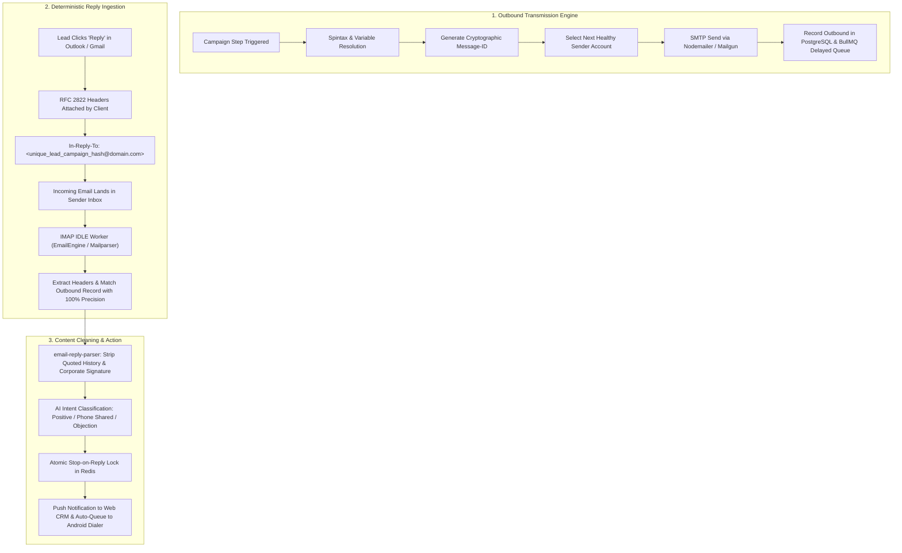
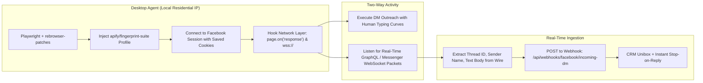
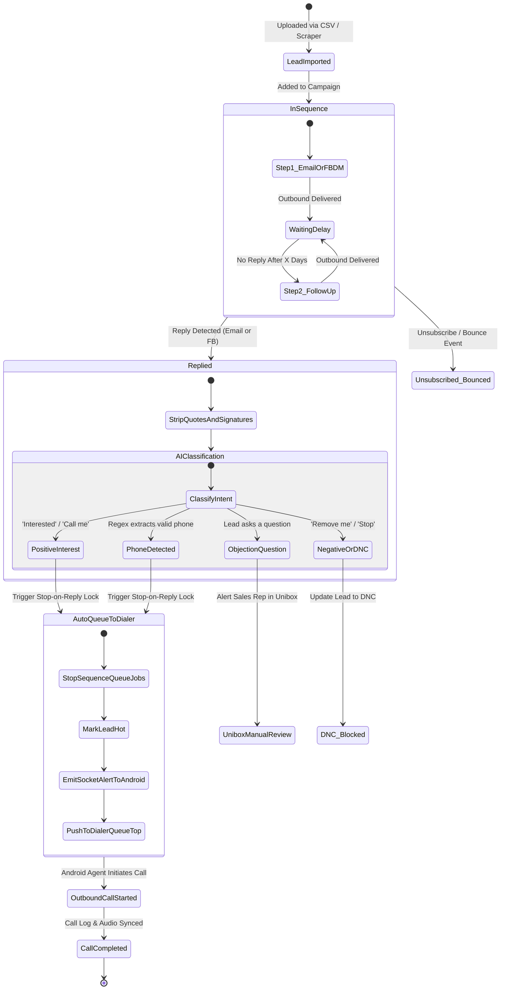
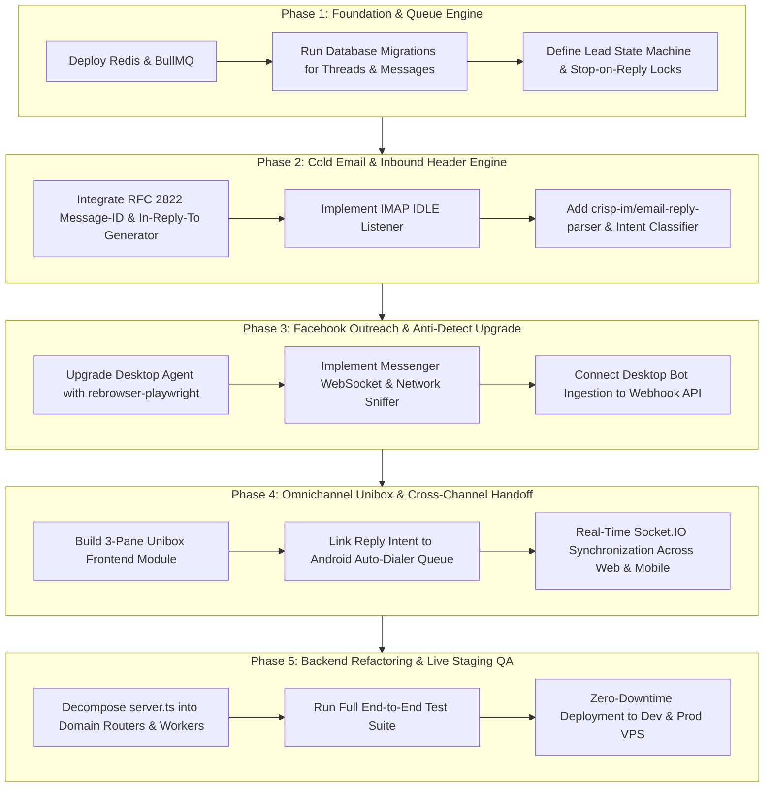

# Omnichannel Outreach & Reply Detection: Master Architectural Blueprint

> **Status:** Planning & Architectural Design Phase  
> **Target Platforms:** Cold Email (Smartlead/Instantly-grade), Facebook Outreach (ReachOwl-grade), Android Cellular Auto-Dialer (`application_octal_dialer`), Desktop Local Agent (`desktop_octal_agent`), and Web CRM (`website_octal_dialer`).  
> **Key Objective:** Build a world-class, fault-tolerant lead generation and outreach ecosystem where 100% of replies from both Email and Facebook are instantly captured, parsed for buying intent and phone numbers, sequence-locked, and auto-routed to the Android cellular auto-dialer for immediate calling.

---

## 1. Executive Summary & Problem Breakdown

Currently, our lead generation software consists of three operational components:
1. **Web Platform & Backend** (`website_octal_dialer/`): Houses CRM routes, user authentication, and basic background sending loops.
2. **Android Telecom Bridge** (`application_octal_dialer/`): Native Kotlin + Flutter telecom integration using real physical SIM cards on Android phones for carrier-grade calling.
3. **Desktop Automation Worker** (`desktop_octal_agent/`): Local Flutter + Node/Playwright worker executing on the user's residential machine.

### Critical Gaps in Existing Architecture:
| Area | Current Implementation | Target World-Class Standard |
| :--- | :--- | :--- |
| **Email Outreach** | Basic `nodemailer` in unmanaged background async loop inside Express | Multi-account pool rotation, warmup schedules, Spintax, BullMQ persistent retry queues |
| **Email Reply Detection** | **None.** No IMAP listener, no thread matching, no reply status | Real-time IMAP IDLE push, deterministic RFC 2822 header matching (`Message-ID`, `In-Reply-To`, `References`) |
| **Email Content Parsing** | Raw HTML/text, signature and quote noise | Quote and signature stripping (`email-reply-parser`), AI intent classification (`positive`, `meeting`, `phone_shared`, `ooo`, `dnc`) |
| **Facebook Outreach** | DOM-based group share button clicks | Stealth CDP anti-detect, Facebook Messenger DM outreach, WebSocket wire sniffing (`edge-chat.facebook.com`) |
| **Sequence Control** | Manual stop or full list send | Atomic **Stop-on-Reply** across all channels (Email + FB) the moment a response is detected |
| **Cross-Channel Handoff** | Disconnected data silos | Instant lead promotion: When a lead replies or shares a phone number, auto-queue to Android Auto-Dialer with conversation context |
| **Code Architecture** | `server.ts` (~12,300 lines) and `CRMWorkspacePage.tsx` monoliths | Domain-driven modular routers, isolated BullMQ worker processes, clean 3-pane Unibox |

---

## 2. Reverse-Engineering the World's Best Outreach Platforms

### 2.1 Cold Email Benchmark: Smartlead.ai & Instantly.ai



#### Why RFC 2822 Inbound Header Matching is Mandatory:
Simple reply matchers compare `lead.email == reply.from`. **This fails in 25-35% of real-world enterprise sales:**
- The lead forwards the email internally, and their CTO or Procurement VP replies from a different email address.
- The lead replies from an alias (e.g. sent to `john@acme.com`, replied from `john.doe@acme-holding.com`).
- The lead's display name or email formatting changes.

**The Fix (Smartlead/Instantly Standard):**
Every outbound email includes:
```http
Message-ID: <msg_{campaignId}_{leadId}_{stepIndex}_{salt}@{sendingDomain}>
```
When *any* standard email client (Gmail, Outlook, Apple Mail, Thunderbird) replies, it strictly copies this header into:
```http
In-Reply-To: <msg_{campaignId}_{leadId}_{stepIndex}_{salt}@{sendingDomain}>
References: <msg_{campaignId}_{leadId}_{stepIndex}_{salt}@{sendingDomain}>
```
By parsing the `In-Reply-To` header, our system achieves **100% deterministic lead and campaign identification**, with zero ambiguity.

---

### 2.2 Social / Facebook Outreach Benchmark: ReachOwl, HeyReach, PhantomBuster



#### Why Standard Playwright Fails & How We Fix It:
1. **CDP Detection Leaks:** Standard Playwright attaches via Chrome DevTools Protocol (`Runtime.enable`). Facebook's anti-fraud scripts detect this flag and flag/checkpoint accounts.
   - **Solution:** We implement `rebrowser-patches` (`rebrowser-playwright`), which strips CDP detection vectors entirely.
2. **DOM Selectors Break Daily:** Facebook continually modifies its obfuscated CSS classes (`x1n2onr6`, etc.). Relying on CSS selectors to read incoming messages breaks repeatedly.
   - **Solution (Network Ingestion):** We monitor the network stream directly:
     - Intercept `https://www.facebook.com/api/graphql/` queries matching Messenger threads.
     - Sniff incoming WebSocket frames on `wss://edge-chat.facebook.com/chat-ws`.
     - Extract structured JSON (`{ message_id, thread_id, snippet, timestamp, sender_id }`) straight from the wire.
3. **IP Reputation:** Facebook bans data-center IP addresses (AWS, Oracle, DigitalOcean).
   - **Solution:** All Facebook messaging and session maintenance executes exclusively inside `desktop_octal_agent` on the user's local residential machine.

---

## 3. High-Priority Open-Source Repositories to Leverage

| Repository | Purpose in Our Stack | Replacement For |
| :--- | :--- | :--- |
| **`postalsys/emailengine`** or **`imapflow`** | IMAP IDLE real-time push notifications for incoming emails; robust connection pooling | Periodic dumb polling; unmanaged background loops |
| **`taskforcesh/bullmq`** | Enterprise Redis-backed queue system for sending schedules, retry backoff, and atomic sequence cancellation | Unhandled background async loops in Express |
| **`crisp-im/email-reply-parser`** | Extracts only the fresh reply text; removes quoted historical email threads and email signatures | Cluttered, unreadable reply threads in the CRM |
| **`nodemailer/mailparser`** | High-performance RFC 2822 MIME parser for multipart emails, headers, and attachments | Basic string regex matching |
| **`rebrowser/rebrowser-patches`** | Bypasses CDP runtime bot detection on Chromium/Edge for Facebook automation | Standard `playwright` (which leaks CDP flags) |
| **`apify/fingerprint-suite`** | Generates consistent, mathematically coherent browser fingerprints (Canvas, WebGL, AudioContext) | Static User-Agent strings |

---

## 4. End-to-End Cross-Channel State Machine & Telecom Handoff



---

## 5. System Architecture & Fault-Isolation Blueprint

To guarantee that **nothing ever breaks**, the monolithic `server.ts` (~12,300 lines) and CRM front-end must be decomposed into fault-isolated layers. If an external IMAP connection drops or a Facebook account requires a checkpoint, the web platform and the Android telecom bridge continue running without interruption.

### 5.1 Backend Service Decomposition

```
website_octal_dialer/backend/src/
├── api/                           # Pure HTTP Routers (Fast, stateless)
│   ├── auth/                      # Login, multi-tenant roles, sessions
│   ├── outreach/                  # Campaigns, drip sequences, templates
│   ├── unibox/                    # Unified inbox, threads, messages
│   ├── telecom/                   # Android bridge sync, call logs, active calls
│   ├── crm/                       # Leads, stages, tags, dispositions
│   └── webhooks/                  # Inbound email webhooks, Stripe, etc.
│
├── queues/                        # BullMQ Queue Producers (Redis backed)
│   ├── emailOutboundQueue.ts      # Rate-limited sending queue
│   ├── emailInboundQueue.ts       # Inbound reply processing queue
│   ├── fbTaskQueue.ts             # Dispatcher queue for desktop agent
│   └── intentClassifierQueue.ts   # AI analysis queue
│
├── workers/                       # BullMQ Workers (Independent, auto-restarting)
│   ├── emailOutboundWorker.ts     # SMTP execution, spintax, header generation
│   ├── emailInboundWorker.ts      # RFC header matching, crisp reply stripping
│   ├── intentClassifierWorker.ts  # LLM intent classification, phone extraction
│   └── telecomSyncWorker.ts       # Idempotent call log sync & lead hot-routing
│
├── services/                      # Core Business Logic & State Machines
│   ├── sequenceEngine.ts          # Step advancement, conditional delays
│   ├── rfcHeaderService.ts        # Cryptographic Message-ID generator & validator
│   ├── leadStateMachine.ts        # Single source of truth for lead statuses
│   └── telecomBridgeService.ts    # Socket.IO & MethodChannel contracts
│
├── realtime/                      # WebSockets (Socket.IO)
│   ├── crmSocketHub.ts            # Live updates for Unibox & Lead Queue
│   └── mobileBridgeHub.ts         # Direct telecom link to Android app
│
└── db/                            # PostgreSQL migrations & queries
```

### 5.2 Key Database Schema Additions

```sql
-- 1. Unified Omnichannel Conversation Threads
CREATE TABLE IF NOT EXISTS outreach_threads (
    id VARCHAR(64) PRIMARY KEY,
    "tenantId" VARCHAR(64) NOT NULL,
    "leadId" VARCHAR(64) NOT NULL,
    channel VARCHAR(20) NOT NULL, -- 'email', 'facebook', 'call', 'sms'
    subject VARCHAR(255),
    "externalThreadId" VARCHAR(255), -- FB thread ID or Email root Message-ID
    status VARCHAR(30) DEFAULT 'open', -- 'open', 'replied_hot', 'closed', 'snoozed'
    "unreadCount" INTEGER DEFAULT 0,
    "lastMessageAt" TIMESTAMP WITH TIME ZONE DEFAULT NOW(),
    "createdAt" TIMESTAMP WITH TIME ZONE DEFAULT NOW(),
    "updatedAt" TIMESTAMP WITH TIME ZONE DEFAULT NOW()
);

-- 2. Individual Unified Messages (Inbound and Outbound)
CREATE TABLE IF NOT EXISTS outreach_messages (
    id VARCHAR(64) PRIMARY KEY,
    "threadId" VARCHAR(64) NOT NULL REFERENCES outreach_threads(id) ON DELETE CASCADE,
    "tenantId" VARCHAR(64) NOT NULL,
    "leadId" VARCHAR(64) NOT NULL,
    direction VARCHAR(10) NOT NULL, -- 'outbound', 'inbound'
    channel VARCHAR(20) NOT NULL,   -- 'email', 'facebook', 'call'
    "senderAddress" VARCHAR(255) NOT NULL,
    "recipientAddress" VARCHAR(255) NOT NULL,
    "messageId" VARCHAR(255),       -- RFC 2822 Message-ID
    "inReplyTo" VARCHAR(255),       -- RFC 2822 In-Reply-To
    "references" TEXT,
    "rawHeaders" JSONB,
    "bodyRaw" TEXT,
    "bodyClean" TEXT,               -- Stripped of signatures and quotes
    intent VARCHAR(50),             -- 'positive', 'phone_shared', 'objection', 'dnc', 'ooo'
    "extractedPhone" VARCHAR(50),   -- Phone number detected in reply text
    "sentimentScore" NUMERIC(3, 2),
    "createdAt" TIMESTAMP WITH TIME ZONE DEFAULT NOW()
);

-- 3. Multi-Step Drip Campaigns & Step Sequences
CREATE TABLE IF NOT EXISTS outreach_campaign_steps (
    id VARCHAR(64) PRIMARY KEY,
    "campaignId" VARCHAR(64) NOT NULL,
    "tenantId" VARCHAR(64) NOT NULL,
    "stepNumber" INTEGER NOT NULL,
    channel VARCHAR(20) NOT NULL,   -- 'email' or 'facebook_dm'
    "delayDays" INTEGER DEFAULT 2,  -- Delay relative to previous step
    "delayHours" INTEGER DEFAULT 0,
    subject VARCHAR(255),
    "templateBody" TEXT NOT NULL,
    "createdAt" TIMESTAMP WITH TIME ZONE DEFAULT NOW()
);
```

---

## 6. Frontend Unibox & Outreach UI Blueprint

Rather than cluttering `CRMWorkspacePage.tsx`, the Outreach experience will be organized into a dedicated **Unibox & Omnichannel Hub**:

```
+-------------------------------------------------------------------------------------------------------+
|  ZESTIFY CRM  |  [Dashboard] [Leads] [Campaigns] [Unibox (3)] [Dialer Hub] [Settings]   [Phone: Connected 🟢]|
+-------------------------------------------------------------------------------------------------------+
|  FILTER CHANNELS  |  THREAD LIST (Sorted by Most Recent)   |  CONVERSATION TIMELINE & ACTION DRAWER    |
|                   |                                        |                                           |
|  [x] All (124)    |  * Sarah Jenkins - Acme Corp           |  Sarah Jenkins <sjenkins@acme.com>        |
|  [ ] Email (89)   |    "Yes, give me a call at 312-555...  |  Channel: Email | Status: 🔥 HOT LEAD      |
|  [ ] Facebook (22)|    🔥 HOT LEAD - Phone Shared (2m ago) |                                           |
|  [ ] Phone Calls  |                                        +-------------------------------------------+
|                   |  * Michael Chang - Horizon Tech        |  [Outbound Email - Oct 20, 10:15 AM]       |
|  FILTER STATUS    |    "Can you share pricing details?"    |  "Hi Sarah, saw your recent post on..."   |
|  (o) Unread (3)   |    💬 Objection / Question (1h ago)    |                                           |
|  ( ) Hot Leads (8)|                                        |  [Inbound Reply - Today, 11:42 AM]        |
|  ( ) Closed       |  * Dave Miller (Facebook DM)           |  "Yes, give me a call at 312-555-0199."   |
|                   |    "Sounds interesting, let's connect" |                                           |
|                   |    🔥 HOT LEAD (3h ago)                +-------------------------------------------+
|                   |                                        |  [📞 1-CLICK CALL ON ANDROID PHONE]       |
|                   |                                        |  [Mark Qualified]  [Snooze]  [Reply Email]|
+-------------------------------------------------------------------------------------------------------+
```

### Key UI Features:
1. **Unified Timeline:** Displays Emails, Facebook DMs, and Phone Call recordings in one single chronological feed per lead.
2. **Intent Badges:** Color-coded pills (`🔥 Hot Lead (Phone Shared)`, `💬 Question/Objection`, `🏖️ Out of Office`, `🚫 Unsubscribe`).
3. **1-Click Call Button:** Instantly instructs the connected Android phone (`application_octal_dialer`) to dial the contact's carrier number via physical SIM, popping the active call drawer.
4. **Phone Status Bar:** Real-time indicator displaying the Android device's battery, SIM signal strength, and connectivity status.

---

## 7. Phased Implementation Roadmap



### Phase Details:
- **Phase 1 (Foundation & Queues):** Set up Redis on the server, configure BullMQ queues, create database tables (`outreach_threads`, `outreach_messages`, `outreach_campaign_steps`), and build the atomic Stop-on-Reply state machine.
- **Phase 2 (Cold Email & Inbound Headers):** Update outbound email delivery with cryptographic `Message-ID` headers; set up an IMAP IDLE listener to receive incoming emails instantly; integrate `email-reply-parser` to strip signatures and quoted text; run LLM classification for intent.
- **Phase 3 (Facebook Engine Upgrade):** Upgrade `desktop_octal_agent` using `rebrowser-playwright` and `apify/fingerprint-suite` for anti-detect automation; hook network responses and WebSocket frames on Messenger to capture replies directly from JSON; dispatch events to the central backend.
- **Phase 4 (Omnichannel Unibox & Dialer Handoff):** Construct the 3-pane Unibox in the frontend; hook positive reply detection directly to the Android dialer socket bridge so hot leads immediately queue up on the rep's phone.
- **Phase 5 (Refactoring & Staging):** Systematically extract routes and workers from `server.ts` without touching existing MethodChannel contracts; verify on `dev.zestify7.online`; deploy to production with zero downtime.
